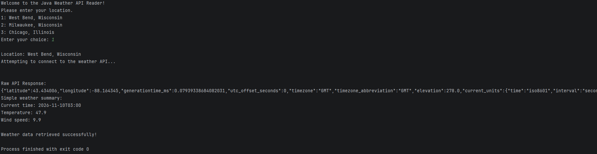

# Weather Data API Reader

This is a program that uses the open-meteo API to allow the user to view weather data on their selection of three choices.

# How to Run

After building the program into a jar, it can be ran by using `java -jar WeatherDataAPI.jar`.

# Images

